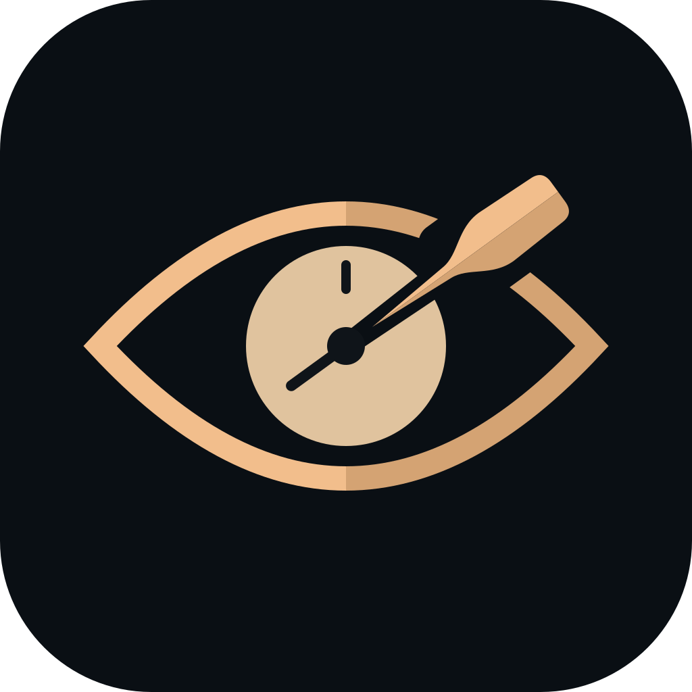

<div align="center">
  

  # Nostak (Νόστος)
  ### Navegando pelo Foco Profundo • Bloqueador de Distrações Nível SO

  [](https://github.com/sallesfx/nostak/releases)
  [](https://github.com/sallesfx/nostak/actions)
  [](LICENSE)
  [](https://tauri.app)
  [](https://www.rust-lang.org)
  [](https://nostak.app)

  <p align="center">
    <b>Se você já fechou dez extensões de navegador para voltar a procrastinar, o Nostak ancora sua atenção na raiz do computador.</b>
  </p>

  <p align="center">
    <a href="https://nostak.app"><strong>Conheça o Site Oficial »</strong></a>
    &nbsp;•&nbsp;
    <a href="https://github.com/sallesfx/nostak/releases/latest"><strong>Baixar Instaladores »</strong></a>
    &nbsp;•&nbsp;
    <a href="https://github.com/sallesfx/nostak/issues"><strong>Reportar Issue »</strong></a>
  </p>
</div>

---

## 🌊 O Que é o Nostak?

O **Nostak** (inspirado no grego *Nóstos* — a jornada de regresso ao lar através de mares tempestuosos na Odisseia) é uma aplicação desktop de produtividade profunda construída com **Tauri v2** e **Rust**.

Diferente de extensões frágeis de navegador que podem ser desativadas em dois cliques ou burladas com uma simples janela anônima, o Nostak acopla o temporizador Pomodoro ao **bloqueio real no arquivo hosts do sistema operacional**.

Quando você clica em **Zarpar**, o ruído digital é neutralizado em nível de rede antes mesmo de sair da sua máquina. Ao atracar em **Porto Seguro**, a conexão é restaurada instantaneamente.

---

## ✨ Principais Capacidades

- 🛡️ **Blindagem Nível Sistema Operacional**: Bloqueio dual-stack IPv4 (`0.0.0.0`) e IPv6 (`::1`) contra contorno por *Happy Eyeballs* (RFC 8305).
- ⛵ **Aegean Minimalist Focus Design System**: Interface dark zenital livre de distrações, tipografia balanceada (EB Garamond + Geist/Inter) e rigor normativo de acessibilidade **WCAG 2.2 AA**.
- 📖 **Diário do Navegador & Templates de Rota**: Vincule tarefas ativas ao temporizador e carregue rotas prontas (*Sprint de Código*, *Escrita Técnica*, *Deep Work*) com um clique.
- 🔔 **Sino Náutico Sintetizado**: Áudio procedural relaxante gerado via Web Audio API local (sem arquivos de som pesados externos).
- 🗺️ **A Rota para Ítaca**: Acompanhamento tangível de milhas navegadas de foco e sereias (distrações) silenciadas ao longo do tempo.
- 🔒 **Privacidade Estrita & Offline-First**: 100% dos seus dados permanecem no seu computador. Sem telemetria, sem contas na nuvem, sem anúncios e com Content Security Policy (CSP) fechada (`connect-src 'none'`).
- ⚡ **Desbloqueio de Emergência & Autorrecuperação**: Rotinas no Rust desfazem bloqueios graciosamente em caso de interrupção inesperada do processo (`SIGINT`/`SIGTERM`/panic hook).

---

## 🏛️ O Método Tradicional vs. O Mecanismo Nostak

| Vetor de Análise | Extensões de Navegador | Mecanismo Nostak (Hosts + Rust) |
| :--- | :--- | :--- |
| **Escopo de Ação** | Apenas dentro do navegador ativo | Todo o sistema operacional (todos os navegadores e apps) |
| **Resistência a Abas Anônimas** | ❌ Facilmente contornável | ✅ Bloqueio no kernel da rede (imune a janelas privadas) |
| **Facilidade de Sabotagem** | ❌ Desativada com 2 cliques | ✅ Exige confirmação explícita de sistema |
| **Consumo de Memória** | Alto (centenas de MBs por processo) | Mínimo (~25–35 MB de RAM via Tauri v2) |
| **Privacidade** | Histórico lido por extensões de terceiros | Zero envio de pacotes externos |

---

## 🚀 Instalação e Download

Consulte a página de [**Releases Oficiais**](https://github.com/sallesfx/nostak/releases) para baixar a versão mais recente.

### Linux (.deb e AppImage)
```bash
# Para distribuições baseadas em Debian/Ubuntu:
sudo dpkg -i nostak_*_amd64.deb

# Ou execute diretamente o executável universal portátil:
chmod +x nostak_*_amd64.AppImage
./nostak_*_amd64.AppImage
```

*(Suporte nativo com instaladores para Windows e macOS está planejado no roadmap).*

---

## 🛠️ Desenvolvimento Local

### Pré-requisitos
1. [Node.js](https://nodejs.org/) (versão 18+)
2. [Rust Toolchain](https://rustup.rs/) (versão 1.75+)
3. Dependências de sistema do Tauri no Linux:
   ```bash
   sudo apt-get update && sudo apt-get install -y \
     libwebkit2gtk-4.1-dev \
     build-essential \
     curl wget file \
     libxdo-dev \
     libssl-dev \
     libayatana-appindicator3-dev \
     librsvg2-dev
   ```

### Executando em Modo Desenvolvimento
```bash
# 1. Clone o repositório
git clone https://github.com/sallesfx/nostak.git
cd nostak

# 2. Instale as dependências de estilo
npm install

# 3. Compile o CSS estático
npm run build:css

# 4. Inicie a aplicação com hot-reload do Tauri
cargo tauri dev
```

### Executando a Suíte de Verificação e Testes
```bash
# Testes unitários do backend Rust
cargo test --manifest-path src-tauri/Cargo.toml

# Análise estática com regras estritas do Clippy
cargo clippy --manifest-path src-tauri/Cargo.toml --all-targets -- -D warnings

# Verificação de formatação
cargo fmt --all --manifest-path src-tauri/Cargo.toml -- --check
```

---

## 🔒 Arquitetura de Segurança & Engenharia

- **Linearizabilidade de I/O Desacoplado**: O gerenciamento de estado em memória utiliza `Arc<RwLock<Config>>`, isolando escritas concorrentes do lock síncrono de disco (`io_lock`).
- **Persistência Atômica**: Gravações de arquivos locais utilizam arquivos temporários (`.tmp`) sucedidos de substituição atômica no sistema de arquivos (`fs::rename`), prevenindo corrupção de dados em quedas de energia.
- **Sanitização RFC 1035**: Validação estrita de FQDN contra injeção de caracteres de controle (CRLF) nas entradas do arquivo hosts.

---

## 📄 Licença

Este projeto é software livre licenciado sob os termos da [Licença MIT](LICENSE).

---

<div align="center">
  <sub>Construído com disciplina por <a href="https://github.com/sallesfx">Marcelo Salles (@sallesfx)</a>.</sub>
</div>

